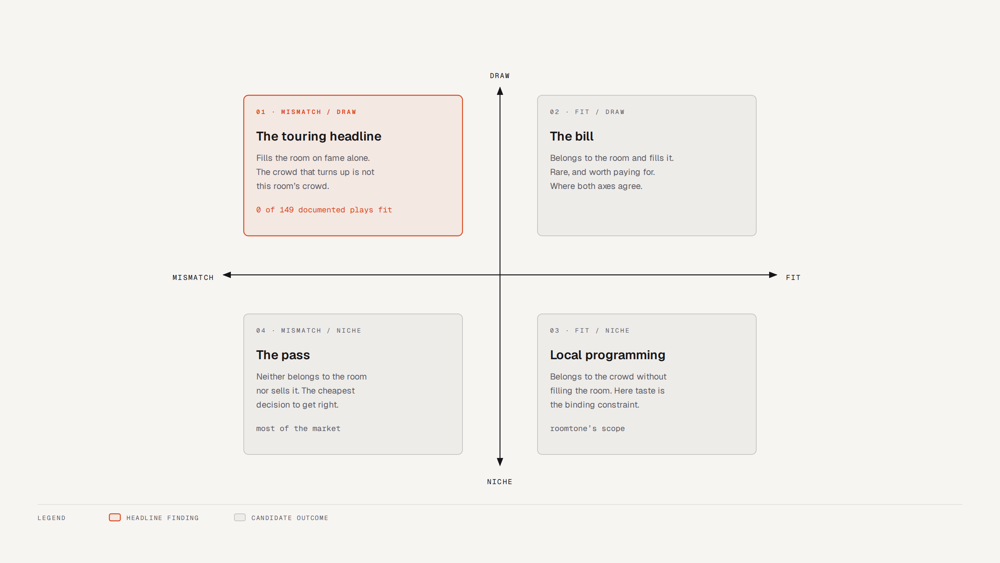
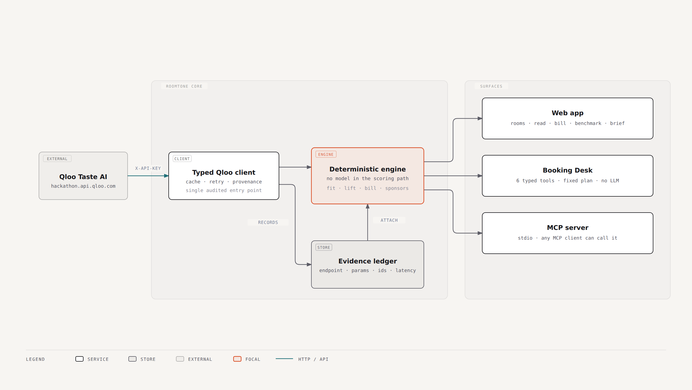

# Roomtone

**Every room has an audience. Almost nobody can tell you what it is.**

Roomtone reads a live-music venue as a *taste object* using [Qloo](https://qloo.com)'s
cultural graph — who the room's local crowd actually is, what they listen to, which acts belong
to them, and which brands already reach them.

**[Live demo →](https://roomtone.fly.dev)** · Apache-2.0 · Built for the **Qloo Agentic Hackathon**

---

> **Read this before the rest.** Roomtone does *not* predict draw. We built an external benchmark to
> test that claim, and it returned a decisive no — zero of 149 documented touring acts appear in the
> venue audience Qloo assigns to the room they played, while ranking by popularity scores 0.995.
> The mechanism is diagnosed below and the benchmark is published in full at
> [`/benchmark`](https://roomtone.fly.dev/benchmark). The product claim was corrected to match the
> evidence rather than the other way round.

---

## The problem

A promoter commits an artist guarantee on a feeling — usually their own. The documented failure mode
is not bad taste, it is *substituted* taste: booking the artist you love into a market that does not
share it. Audience Republic's founder booked a 1,200-cap room, sold 400 of the 700 tickets he needed,
lost $20,000, and named the reason in writing.

The gap is admitted by the industry itself. In a January 2026 submission to the UK Parliament
Business & Trade Select Committee, Live Nation wrote that the only third-party live-music reporting
available is *"self-reported, selective and incomplete."* Box office tells you what happened last
night. Nothing tells you who is in the room.

## What it does

1. **Reads a room.** For a venue, Qloo returns the 50 acts whose audiences sit closest to that
   venue's own crowd. That list is the room's **local audience**, expressed as names.
2. **Places an act in it.** Where does that act fall inside *that room's* distribution? The Stone
   returns a jazz canon — Coltrane Quartet, Vijay Iyer, Wayne Shorter, Ahmad Jamal. Bill Frisell sits
   **#6 of 50**; Bad Bunny is not in it.
3. **Shows the same act everywhere.** Yves Tumor is **#1 at Webster Hall** and **0th percentile** at
   Radio City, The Stone, Beacon Theatre and Music Hall of Williamsburg.
4. **Maps the scene.** Rooms are compared by intersecting their top-act lists. The Stone shares
   **34 of 50 acts** with Scholes Street Studio and **33** with Sear Sound — the real downtown jazz
   circuit, with the shared acts named on the page.
5. **Finds who already buys.** Pier 36's crowd returns Flight Club, Mitchell & Ness, Rocawear and
   Billionaire Boys Club; KOKO's returns Trapstar, Footasylum and JD. Composed from the room's own
   local acts, because brand affinity is sharp from an act and diffuse from a venue.
6. **Prints the Brief.** A one-page document with the room read, the cross-room comparison and the
   sponsorable categories.



## What the evidence says

Two tests, both published, both falsifiable.

### The ablation — built the alternative and measured it

The brief says *"if your submission would work the same without Qloo, you're building the wrong
thing."* So we built the incumbent method properly — **rank by popularity, break ties by genre
bucket**, the same candidate pool, no taste-graph signal anywhere — and measured the disagreement
across every room:

| | |
|---|---|
| Median rank correlation between the incumbent method and Roomtone | **ρ = 0.14** |
| Rooms where the two disagree on what to book (\\|ρ\\| < 0.2) | **16 of 22** |
| Popularity↔affinity correlation *inside* a room | **0.10 – 0.43** |

That last row is why the fit score is a percentile and not a raw affinity: raw Qloo affinity
substantially tracks fame, so `lift` subtracts the room's expected affinity at the act's popularity
tier. → [`/baseline`](https://roomtone.fly.dev/baseline)

### The external benchmark — the result that changed the product

Ground truth is **Wikipedia tour date tables**: 943 documented shows across 161 venues from 57 major
tours, resolved to 34 Qloo entities and verified against each entity's own geocode. 29 venues carried
enough history to test, giving 149 measurable plays. For each venue: does Roomtone score the acts that
*actually played there* above plausible acts that didn't?

| | |
|---|---|
| Draw (popularity) AUC | **0.995** |
| Taste-fit AUC | **0.000** |
| Documented touring acts appearing in their venue's top 50 | **0 of 149** |

**The mechanism, not just the null.** AFAS Live in Amsterdam is documented to host Harry Styles and
Halsey; Qloo's read of that room is Dutch-language pop — Nielson, Gers Pardoel, Bløf. Oslo Spektrum
hosts Dua Lipa; its read is Norwegian-language acts. Rogers Arena gets EDM DJs.

**Qloo place affinity describes a venue's local audience, not the touring draw that fills it.**
Touring decisions are made on draw, and popularity predicts draw almost perfectly. Those are two
independent variables, and the original build collapsed them into one number. That is what the test
was for. → [`/benchmark`](https://roomtone.fly.dev/benchmark)

### The algorithm

Choosing who plays a room is a set problem, not a ranking problem: two acts who draw the same crowd
are duplication. `bill.ts` runs **greedy maximum coverage** over each act's taste footprint — which is
monotone submodular, so greedy carries a (1 − 1/e) ≈ 63% approximation bound.

Beacon Theatre's generated bill — Mike Gordon, Joni Mitchell, Miles Davis, Captain Beefheart, The
Band — covers **59%** of the room's audience signature. Booking the top five by affinity covers
**16%**. Average gain across all rooms: **+47 points**. → [`/bill`](https://roomtone.fly.dev/bill)

## Architecture



**One audited path from Qloo to a decision.** Every number the product puts in front of a user comes
through a single logged client. There is no path from any surface to a measurement whose request was
not recorded.

| Source | |
|---|---|
| `src/lib/qloo/` | typed client — retry/backoff, two-tier cache with stale-serving, provenance ledger |
| `src/lib/roomtone/` | the engine — room profiles, fit percentiles, lift, bill coverage, scene overlap, sponsorship composition, catalogue |
| `src/lib/agent/` | the Booking Desk — tool registry and deterministic planner |
| `src/mcp/` | stdio MCP server over the same tool surface |
| `src/app/` | eight routes: `/`, `/rooms/[id]`, `/read`, `/two-rooms`, `/brief`, `/desk`, `/baseline`, `/benchmark`, `/method` |

**The evidence layer is not a debug view — it is the product.** Every view carries an `Evidence` panel
listing each Qloo request verbatim: endpoint, parameters, resolved entity ids, status, latency, result
count and cache state. A taste *claim* becomes a taste *measurement* only if the request underneath it
is inspectable.

**Qloo surface used:** `/search`, `/v2/insights` (`urn:entity:artist`, `urn:entity:place`,
`urn:entity:brand`), `/v2/audiences`, plus `filter.results.entities` for single-act affinity. Cache is
slimmed at the boundary to the fields we render, and warmed for all 22 catalogued rooms so a demo
never waits on the API.

### The Booking Desk is not a chatbot

`/desk` parses a booking question, resolves the room and act against Qloo's graph, runs a fixed plan of
typed tools, and narrates the result — including what it could not establish. **There is no language
model behind it.** A booking verdict that changes because a model had a bad afternoon is worse than no
verdict, and this product's entire claim is that the number is measured rather than generated. The
tool surface lives behind an interface a model *could* be dropped into; shipping without one keeps the
demo deterministic and reproducible. Its limitation — it will not answer outside its plan — is stated
on the page rather than hidden.

### MCP server

Roomtone's measurement tools are exposed over the Model Context Protocol, so any MCP client can ask
"who draws this room" and get a measured answer with its provenance attached.

```bash
pnpm mcp     # stdio server, requires QLOO_API_KEY
```

```json
{
  "mcpServers": {
    "roomtone": { "command": "node", "args": ["dist/mcp/server.js"] }
  }
}
```

Tools: `list_rooms`, `read_room`, `measure_fit`, `find_act`, `sponsor_fit`. Every response carries the
Qloo calls that produced it.

## Quick start

```bash
pnpm install
cp .env.local.example .env.local   # add your QLOO_API_KEY
pnpm warm                          # pre-fetch every room so nothing stalls
pnpm dev                           # http://localhost:3111
```

The Qloo hackathon credential works only against `https://hackathon.api.qloo.com`, which is the
default in `.env.local.example`.

```bash
pnpm typecheck   # tsc --noEmit
pnpm test        # exercises the real Qloo client through its cache
pnpm build:all   # Next.js standalone + compiled MCP server
```

### Deploy

```bash
fly launch --no-deploy
fly volumes create roomtone_data --size 1
fly secrets set QLOO_API_KEY=hack_...
fly deploy
```

A container rather than a serverless function: Roomtone holds a warm response cache on disk and can
spawn the MCP subprocess, both of which need a long-lived process with a real filesystem. The
entrypoint seeds the pre-warmed cache onto the volume on first boot, so a cold machine answers
instantly and never rate-limits during a demo.

## Method, and limits

Full detail at [`/method`](https://roomtone.fly.dev/method). The short version.

**Measured:** an act's percentile within a room's own distribution of top acts; a room's local
audience as a named act list; room-to-room audience overlap by act-set Jaccard; brand reach composed
from a room's local acts; bill coverage under greedy max-coverage.

**Not measured:** draw, ticket sales, capacity, pricing or guarantee maths; anything about an
individual person; rooms Qloo has no taste signal for; causation.

### Traps found while building this

Each of these silently produced wrong answers before it was caught. They are listed because a reader
should know which failure modes this kind of work actually has.

| Trap | What happened | Handling |
|---|---|---|
| **Same-named venues** | A dozen venues are called "The Stone". Qloo's own `/v2/analysis/compare` silently resolved ours to a **Denver club**. | Every room is pinned by id and verified against its own geocode. Four candidates were dropped rather than shipped mislabelled. |
| **Entity mis-resolution** | Qloo mapped **"Nate Barbrack" → "Nate Dogg"**. | Weak matches are labelled and never auto-selected; the warm script refuses to cache one. |
| **Rate limits read as data** | A `429` was reported as "not measured" — a transport failure masquerading as a confident result. | Failure and absence are separate states; a failed request throws. |
| **`/v2/analysis/compare` is hollow here** | Returns only "Place", "Tourist Attraction" — true of every venue. | Dropped. Overlap is measured on act lists, and the shared acts are named on the page. |
| **Malformed tags** | Qloo can return a tag with only a `type` and no `name`, which 500s any page that renders it. | Dropped at the client boundary. |
| **Build-time credential guard** | A guard that threw without a key broke `next build` itself on any machine without the credential — including CI and the Docker stage. | Request-time error instead. |
| **A capability that wasn't there** | `urn:entity:heatmap` is not supported in this environment. | Cut rather than faked. |

## Data handling

Qloo affinities describe **aggregate cultural co-occurrence**, not individuals. Roomtone sends no
names, email addresses, device ids, account ids or location histories to Qloo — only public entity
names and venue localities, themselves public cultural facts. Nothing Roomtone produces is used for
any decision about a person.

Per Qloo's safe-use guidance: results are presented with their source and limits, affinities are never
described as causal claims about individuals, and the product refuses to output a profile when the
underlying signal is missing.

## Licence

Apache-2.0. Cultural data by [Qloo](https://qloo.com).
